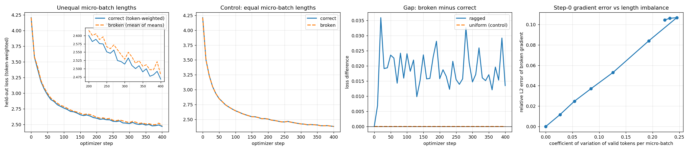
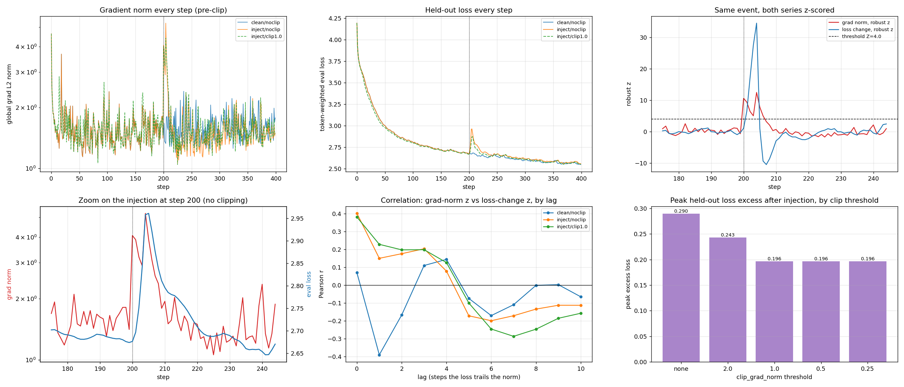
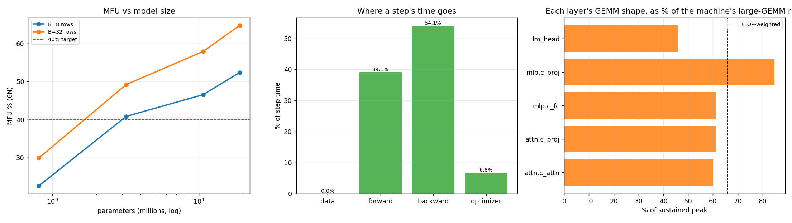
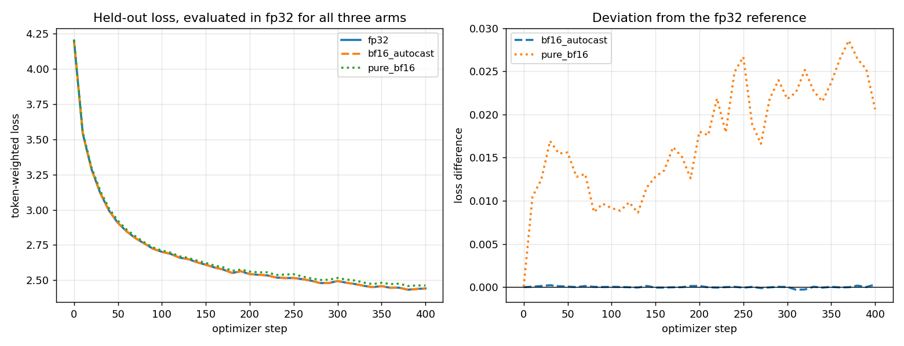

# ERA V5 — Session 10

**Take a small model and a real loop, and make it tell you the truth about itself.**

Every number below was produced by a script in `src/` and written to JSON in
`artifacts/`. Three test suites keep it honest: `test_invariants.py` asserts that each experiment says
what this README claims it says, reading the artifacts rather than recomputing them;
`test_readme_claims.py` asserts that every number typed into this file is the number its
artifact actually contains; and `test_gpu_path.py` exercises the CUDA branches from a
machine with no GPU. A stale README fails the build — the second suite caught three wrong
numbers in the first draft of this one.

```bash
pip install -r requirements.txt
python src/run_all.py      # regenerates every artifact and figure
python -m pytest tests/ -q # 131 passed
```

Walkthrough with live output: **[`session10.ipynb`](session10.ipynb)**

---

## The model

nanoGPT-shaped decoder, small enough that every experiment here finishes on one CPU core.

| | |
|---|---|
| parameters | 809,856 |
| layers / heads / n_embd | 4 / 4 / 128 |
| head_dim | 32 |
| context `T` | 64 |
| vocabulary | 65 characters (tinyshakespeare) |
| output head | tied to the input embedding |

The config was chosen so `B=8`, `T=64`, `V=65`, `head_dim=32`, `C=128`, `3C=384` and
`4C=512` are all different numbers. That is not cosmetic — see Task 1.

---

## Task 1 — every tensor shape in the step

`src/t1_shapes.py` → `artifacts/t1_shapes.json`

52 parameter tensors, 22 traced activations, 52 gradients, 104 Adam state tensors, each
with a per-axis gloss rather than one sentence per tensor.

The axis meanings are **declared symbolically** (`B`, `T`, `C`, `3C`, `H`, `Dh`, …) and
then asserted against the real tensor, so a wrong label raises instead of printing.

**This caught its own bug.** The first version inferred meaning from the size, and
labelled the *input* axis of every weight matrix as "sequence position" — because
`block_size` happened to equal `n_embd`, both 128. Two fixes: declare rather than infer,
and pick dimensions that never collide.

```
attn.scores              (8, 4, 64, 64)
      8:  B - independent sequences in this micro-batch
      4:  H = n_head - attention heads, computed in parallel with no interaction
      64: T - sequence positions
      64: T (key positions) - what each query position is allowed to attend to
```

Every one of the four blocks is traced, not just the first. They turn out to have
identical activation shapes, which is asserted rather than assumed — a shape that drifted
between layers would be a real bug and this is where it would surface.

| | tensors | parameters |
|---|---|---|
| top-level (`wte`, `wpe`, `ln_f`) | 4 | 16,768 |
| block 0 | 12 | 198,272 |
| block 1 | 12 | 198,272 |
| block 2 | 12 | 198,272 |
| block 3 | 12 | 198,272 |

All 52 tensors are trainable; the per-layer counts sum to the total, which is a test.

Three things the ledger makes explicit rather than leaving implicit:

- `lm_head.weight` **is** `wte.weight` — same `data_ptr`, so `named_parameters()` yields
  it once and the parameter count does not double-charge for it.
- Gradient shape equals parameter shape for all 52 tensors.
- Adam holds exactly two state tensors per parameter tensor, each the parameter's shape.

**What a step costs, per parameter:** 2 (bf16 weight) + 2 (bf16 grad) + 4 (fp32 master)
+ 4 + 4 (Adam `m`, `v`) = **16 bytes**. For this model, 12.36 MiB. At 120B on the same
recipe, **1.75 TiB** per checkpoint — which is the resumable training state, not the
model you ship.

---

## Task 2 — verify one gradient by hand

`src/t2_finite_diff.py` → `artifacts/t2_finite_diff.json`

Central difference `(L(w+h) − L(w−h)) / 2h`, error O(h²) rather than O(h), swept across
six decades of `h`, on eight probes spanning embedding, attention, MLP, LayerNorm and the
tied output head.

| | worst | median |
|---|---|---|
| **fp64** | **8.51** significant digits | 9.44 |
| **fp32** | **0.39** significant digits | 2.67 |

One probe exists specifically to test something: `wte.weight` is tied to `lm_head.weight`,
so perturbing a single scalar there moves *both* the input embedding and the output
logits. If autograd accumulated only one of the two paths, that entry would fail. It
agrees to 8.68 digits.

### A second opinion on my own harness

Everything above is my finite-difference code checking PyTorch. If *that* has a bug — a
sign error, a weight left perturbed, the wrong flat index — it could agree with autograd
for the wrong reason and nothing here would notice. So `torch.autograd.gradcheck`, an
implementation I did not write, is run over four parameter tensors of a 2-layer fp64
model. All four pass. That checks the harness, not the engine.

### The fp32 collapse is the finding

`blocks.1.ln_1.weight`: autograd says −8.0022e-5, the finite difference says −4.7684e-5.

That is not a bug in `backward()`. `L(w+h)` and `L(w−h)` are two nearly-equal numbers, and
subtracting them destroys most of the significant digits — fp32 carries about 7.22 decimal
digits total, and the difference is where they go. Shrinking `h` makes it worse, not
better, which is why fp32's best result comes from the *largest* step size tested.

The same argument, in bits, is Task 6.

---

## Task 3 — break gradient accumulation on purpose

`src/t3_accum.py` → `artifacts/t3_accum.json` · `figures/t3_accum.png`

```
correct : sum_i (sum of per-token losses in i) / sum_i n_valid_i
broken  : mean_i ( mean of per-token losses in i )
```

These are algebraically identical whenever every micro-batch scores the same number of
tokens — which is exactly why it went unnoticed for so long. Packed fixed-length
pretraining never triggers it. Padding and prompt-masked post-training do.

**Checked against the record, not just the lecture.** Unsloth documented this publicly in
October 2024 and Hugging Face fixed `Trainer` by threading a `num_items_in_batch` count
through so the loss divides by prediction targets rather than by a step count. But "fixed
in 2024" is too tidy a story, and an earlier draft of this README said exactly that. The
same distortion also appears across data-parallel ranks, each averaging locally before the
ranks are averaged together, and as of 2026 it is documented as still present in several
widely used post-training libraries — verl only fixed it in November 2025. It is a live
bug, not a historical one.

### Step 0, against a no-accumulation reference

The reference is one forward over everything concatenated — what you would compute with
enough memory to skip accumulation entirely. Computed in fp64.

| micro-batch lengths | reduction | relative L2 error | cosine |
|---|---|---|---|
| ragged `[46, 90, 59, 65]` | correct | 2.0e-16 | 1.000000000 |
| ragged `[46, 90, 59, 65]` | **broken** | **0.110** | 0.993941 |
| uniform `[256, 256, 256, 256]` | correct | 3.0e-16 | 1.000000000 |
| uniform `[256, 256, 256, 256]` | **broken** | **3.0e-16** | 1.000000000 |

The uniform row is the **control**. If those two had differed, the ragged gap would be
measuring some other difference between the code paths, and the whole experiment would be
worthless.

### 400 training steps

| | correct | broken | gap |
|---|---|---|---|
| ragged | 2.468379 | 2.481853 | **+0.013474** |
| uniform | 2.381348 | 2.381348 | **0.000000** |

Mean gap over the second half: **+0.0180**. Positive at **100%** of evaluation points.
The uniform control is zero at every point, exactly.

### Why it went unnoticed

An **11% error in the gradient** produces a **0.018 gap in the loss** — about 0.7% in
relative terms, fifteen times smaller than the error causing it. Loud where nobody was
looking, nearly silent where everybody was. That asymmetry is the whole answer to how it
survived review in codebases many people were reading. The two curves in the left panel of the figure
sit on top of each other; you need the difference plot to see anything at all.



*Left: the two curves sit on top of each other, which is the point — the inset zooms the
second half. Middle: the equal-length control, exactly coincident. Right: the gap, positive
at every evaluation point for ragged and identically zero for uniform. Far right: the
gradient error against the realised length imbalance.*

### The bug scales with imbalance

Sweeping the length distribution: the broken gradient's relative L2 error is cleanly
monotone in the coefficient of variation of valid tokens per micro-batch, running from
2e-16 at perfectly equal lengths to 0.107. It saturates past σ≈1.2 only because the
lognormal tail gets clipped at `T`, so the realised imbalance stops growing — noted in the
artifact so the flat top is not mistaken for a real ceiling.

---

## Task 4 — the grad norm moves before the loss

`src/t4_gradnorm.py` → `artifacts/t4_gradnorm.json` · `figures/t4_gradnorm.png`

A four-step window of out-of-distribution text is injected at step 200 of a 400-step run.

### The injection

The text is **Sanskrit in Harvard-Kyoto transliteration**. HK is pure ASCII, and every
character in the injection corpus is already in the Shakespeare vocabulary — asserted in
the tests, zero out-of-vocab characters. The tokenizer genuinely cannot tell the two
apart.

That is the session's own example — Sanskrit leaking into a Hindi run, where a
script-based filter sees Devanagari either way — reproduced somewhere it can be measured.
Familiar characters, wholly unfamiliar distribution, and the only thing that notices is
the gradient.

### What was measured, decided before looking

At step `k`: record `eval_loss[k]` and `grad_norm[k]` at θ_k, *then* step to θ_{k+1}. Both
series get a trailing 50-step robust z-score (median / MAD), threshold Z=4. The loss is
used as its step-over-step *change*, because a spike detector run on a smoothly declining
level would fire on ordinary drift.

**A lag of 1 is causal by construction** — the gradient at step `k` can only move the loss
at `k+1` — so it is not evidence on its own. Stated up front, and reported anyway.

### The step the brief asked for

**Step 200, the moment the bad data arrives.** The gradient norm goes 1.411 → 4.075. The
held-out loss reads 2.6763 — **bit-identical to the clean arm, difference exactly
+0.0000**. Not "barely moved". The same number.

| at step 200 | robust z | fires at Z=4? |
|---|---|---|
| grad norm | **10.61** | **yes** |
| loss change | **1.09** | no |

Detectability ratio **9.7×**, and this comparison is free of the one-step ordering
artefact because both are read at the same instant, from the same model state.

**And one with no injection at all.** The clean run produces a lead event at **step 162**,
lag **4**: the grad norm is 1.44× its trailing median (z = 3.61) while the loss change is
unremarkable (z = 1.38), and the loss does not cross the threshold until four steps later
(z = 3.05). That is below the primary Z=4 bar and is reported at the secondary Z=3.0
threshold, with its full step window in the artifact under
`lead_events_at_secondary_threshold`. It is the more interesting of the two, because
nothing was done to the run to produce it.

### How long the damage takes to show

| | |
|---|---|
| injection window | steps 200–203 |
| peak held-out loss | step 205, **+0.290** over clean |
| steps from injection **start** to peak | 5 |
| steps from injection **end** to peak | **2** |
| recovery to 10% of peak | +35 steps |

Both distances are given because quoting only the first would flatter the result — the
window is four steps wide, so the honest number for "how long after the last bad batch" is
2, not 5.

Threshold sensitivity is reported at every Z from 3.0 to 5.0 rather than at the one that
looks best.



*Bottom-left is the one to read: the grad norm (red) jumps at step 200 while the held-out
loss (blue) is still flat, and the loss does not peak until 205. Note the two panels use
different y-axes. Top-right shows both series z-scored against the same threshold.*

### Two results I did not go looking for

**In healthy training, the relationship runs backwards.** Correlation between the
grad-norm anomaly and the next step's loss change, at lag 1:

| arm | r |
|---|---|
| clean | **-0.391** |
| injected | +0.150 |
| injected + clip | +0.229 |

A large gradient in ordinary training means the batch was informative and the loss is
about to *drop*. "Grad norm leads loss" is a property of anomalies, not of training. The
injection flips the sign.

**Clipping helps, then abruptly stops helping.** Peak held-out loss excess after the
injection:

| clip | none | 2.0 | 1.0 | 0.5 | 0.25 |
|---|---|---|---|---|---|
| peak excess | 0.290 | 0.243 | **0.196** | **0.196** | **0.196** |

Tightening below 1.0 buys nothing at all. Clipping caps the gradient's magnitude but
leaves its direction untouched, and Adam already rescales per parameter by its own running
second moment — so what remains is directional damage, which no threshold removes. This
was measured across the sweep rather than asserted after seeing one number.

---

## Task 5 — MFU, measured honestly

<!-- BEGIN GENERATED: task5 -->
<!-- Generated by src/render_readme.py from artifacts/t5_mfu.json. Do not edit
     by hand: re-run `python src/render_readme.py` after re-running Task 5. -->

`src/t5_mfu.py` → `artifacts/t5_mfu.json` · `figures/t5_mfu.png`

> **This is the one section of this repo that does not reproduce to the digit.** Every
> number here is a wall-clock measurement, so the prose below is generated from the
> artifact rather than typed, and the run-to-run spread is measured and quoted with the
> number instead of being hidden behind extra significant figures. Both the step timing
> and the GEMM benchmarks take the *fastest* of several passes, since contention on a
> shared machine can only ever make a timing slower.

Measured on **CPU, float32, 1 thread(s)**.

Two choices keep the number from flattering itself.

**The denominator is measured, not quoted.** A spec-sheet peak is a marketing figure for
one dtype under one sparsity assumption. Here it is the best rate this machine sustains on
the fastest matmul in the training dtype, benchmarked in-process: **148.0 GFLOP/s**, reached
on square 2048.

The sweep deliberately includes the model's *own* GEMM shapes alongside large square ones.
Squares alone are not a safe denominator: a short wide matmul that fits in cache can beat
the biggest square one, and when it does, MFU is being divided by something that is not an
upper bound. The per-layer figures below are read from the same sweep that defines the
peak, so no layer can exceed it by construction — asserted in the tests. (This is not
hypothetical; see Limitations.)

**The numerator is reported under both conventions.** `6N` is what the brief asked for; it
undercounts, because attention's score and value matmuls involve no parameters at all, so
the PaLM-style `12·L·T·C` per token is given too. The headline uses the strict `6N` form.

| | |
|---|---|
| throughput | 9,430 tokens/s |
| **MFU (6N)**, best-of-3 timing pass | **31.0%** |
| MFU (6N) across 4 single-pass trials | **29.6% ± 0.5** (spread 1.1 pp) |
| MFU (6N + attention) | 33.5% |
| distance to 40% | 9.0 pp |

The ± is not decoration. It is larger than several of the differences one might be tempted
to read into the table below, and it is why nothing in this section is quoted past one
decimal.

### Where the distance goes

| cause | cost | how it was measured |
|---|---|---|
| matmul shapes too small | 34.1 pp | the model's *actual* GEMM shapes benchmarked in isolation reach only **65.9%** of the machine's large-GEMM rate |
| time not in matmuls | 4.5 pp | optimizer step 6.8% of a step, data prep 0.0% |
| elementwise residual | 30.4 pp | LayerNorm, GELU, softmax, causal mask, residual adds — counted by neither the `6N` model nor the GEMM benchmark |

**The third row is a remainder, not a measurement.** The first two terms come from
independent benchmarks — a GEMM run at the model's real shapes, and phase timing of the
step. The residual is defined as whatever is left over, so the arithmetic check that the
three sum to the measured MFU *cannot fail*, and the test asserting it is labelled in the
artifact as a coding check rather than evidence. The residual is only as trustworthy as
the claim that the first two terms are exhaustive, which I have not proved.

Per-layer shape efficiency runs 45.8% to 84.8% of that
ceiling. A step splits roughly 39.1% forward,
54.1% backward, 6.8% optimizer.

### It is a size problem, not a code problem

| n_embd | L | B | params | MFU (6N) |
|---|---|---|---|---|
| 128 | 4 | 8 | 0.81M | 22.5% |
| 128 | 4 | 32 | 0.81M | 29.9% |
| 256 | 4 | 8 | 3.19M | 40.8% |
| 256 | 4 | 32 | 3.19M | 49.2% |
| 384 | 6 | 8 | 10.70M | 46.6% |
| 384 | 6 | 32 | 10.70M | 58.0% |
| 512 | 6 | 8 | 18.98M | 52.4% |
| 512 | 6 | 32 | 18.98M | **64.8%** |

MFU rises with both width and batch — a relationship far larger than the
±0.5 pp noise floor — first clearing 40% at n_embd 256, 4 layers, B=8 (3.19M parameters). The baseline's
~31% is not inefficient code; it is a model too narrow to
keep the hardware busy, which is the same trade the session described from the other side:
the V4 run gave up MFU to buy RAM headroom through MoE and reversibility.



### Recomputing the session's V4 number

The transcript is internally inconsistent: it reads *6848 teraflops achieved against 7912
peak* for *8.2% MFU*, and 6848/7912 is 87%. Recomputing from the stated model size and
throughput:

```
6 × 9e9 params × 12,000 tok/s = 648 TFLOP/s
648 / 7,912 = 8.19%        ← matches the 8.2% quoted
```

So the 6848 is a transcription slip for 648, and the formula
reproduces his figure exactly.

<!-- END GENERATED: task5 -->

---

## Task 6 — 0.1 in fp32, bf16 and fp8 E4M3

`src/t6_floats.py` → `artifacts/t6_floats.json`

### Why 0.1 is the right number to be asked about

`1/10` has a factor of 5 in the denominator and no power of 2 clears it, so the binary
expansion never terminates:

```
0.1 = 0.0001100110011001100110011001100110011001... (block 0011 forever)
    = 1.100110011001100... × 2⁻⁴
```

**No binary format stores 0.1 exactly.** `0.5` would have taught us nothing.

### The bits

Derived from each format's definition using exact rational arithmetic — long division,
normalisation, round-to-nearest-even — and only *then* compared against what PyTorch
stores, as a check rather than as the source. **All four match, bit for bit.**

| format | s | exponent | mantissa | stored value | error |
|---|---|---|---|---|---|
| fp32 | 0 | `01111011` | `10011001100110011001101` | 0.100000001490116119 | 0.0000% |
| fp16 | 0 | `01011` | `1001100110` | 0.099975585937500000 | 0.0244% |
| bf16 | 0 | `01111011` | `1001101` | 0.100097656250000000 | 0.0977% |
| **fp8 E4M3** | 0 | `0011` | `101` | 0.101562500000000000 | **1.5625%** |

E4M3 worked through by hand:

```
0.1 = 1.100110011... × 2⁻⁴
exponent : −4 + bias 7 = 3         → 0011
mantissa : 3 bits of 100|1100...   → next bit is 1, tail non-zero, round up → 101
significand 1.101₂ = 1.625
1.625 × 2⁻⁴ = 0.1015625

bits: 0 0011 101      error 1.5625%
```

The encoder is cross-checked against PyTorch on ~600 randomised values per format, not
just the four in the table. That found two bugs a spot-check on `0.1` could never reach:
values in (448, 480] encoded to `01111111`, which is E4M3FN's reserved **NaN code** rather
than a number, and the overflow flag never fired for them. `format_properties` had said 448
all along — the two halves of the file disagreed, and only the randomised check noticed.

**Then the fix turned out to be version-specific.** Running the suite on torch 2.8 rather
than 2.13 failed on exactly one value: 487.96 encodes to `01111110` (saturate to 448) under
2.13 and `01111111` (the NaN code) under 2.8. Nothing about E4M3 changed — overflow is a
property of the **cast**, not of the format, and PyTorch changed its convention. Saturation
is what NVIDIA's Transformer Engine does; the NaN code is what the older cast emitted. The
encoder now takes an explicit `overflow_mode`, the artifact records which convention the
installed PyTorch actually implements, and the cross-check asks for the matching one. Every
in-range value is compared exactly either way, so nothing in the table above depends on
this.

### Range and precision

Every figure below was derived, then checked against `torch.finfo`.

| | bits (s/e/m) | smallest normal | largest finite | decimal digits |
|---|---|---|---|---|
| fp32 | 1/8/23 | 1.18e-38 | 3.40e38 | 7.22 |
| fp16 | 1/5/10 | **6.10e-05** | 65,504 | 3.31 |
| bf16 | 1/8/**7** | **1.18e-38** | 3.39e38 | 2.41 |
| fp8 E4M3 | 1/4/3 | 1.56e-02 | **448** | 1.20 |

bf16 has fp32's exponent field and a gutted mantissa: identical range, coarser steps.
E4M3's maximum is 448 rather than 480 because the all-ones mantissa in the top binade is
reserved for NaN — asserted against `torch.finfo`.

### Which one would I train in

**bf16 for the compute, with an fp32 master copy of the weights and fp32 optimizer state.**

The reason is not the bit widths. It is this table — casting *this repo's own measured
gradients* from one real step into each format:

| format | flushed to zero | median relative error |
|---|---|---|
| fp16 | 0.0782% | 0.0192% |
| **bf16** | **0.0000%** | 0.1350% |
| fp8 E4M3 (raw) | **46.44%** | 15.26% |
| fp16 + global scale | 0.0058% | 0.0170% |
| fp8 E4M3 + global scale | **1.20%** | 2.36% |

These gradients span **13.6 orders of magnitude**, from 1.42e-14 to 5.50e-01.

Note that **fp16 is the more precise format at 0.1** — 0.024% error against bf16's 0.098%
— and it does not help, because precision is not the binding constraint. Range is. fp16's
smallest normal is 6.10e-05; a large part of that 13.6-order span is simply below the
floor. bf16 spends its bits on the exponent instead, keeps fp32's entire range, and lost
**zero** gradients. A gradient rounded slightly wrong still points the right way. A
gradient rounded to zero is a parameter that quietly stopped learning, and you find out
weeks later.

**fp8 E4M3 raw is not usable** — 46% of these gradients go to zero and the median survivor
is off by 15%. But that is a framing problem, not a verdict on the format. One global
scale factor before the cast and its inverse after takes it to 1.20% flushed and 2.36%
median error. That is the trick the session described — "what if I store the divide by
1000 outside" — and what NVIDIA's transformer engine does per tensor. fp8 is a throughput
win worth taking *with* that machinery and a way to lose a run without it.

**The fp32 master copy is not optional**, and Task 2 is the evidence rather than an
appeal to convention: a computation that agreed to 8–10 digits in fp64 collapsed to under
one digit in fp32 through exactly this mechanism — small quantities repeatedly added into
a low-precision accumulator, with cancellation eating the significant bits.

### Does the recommendation survive an actual training run?

`src/t6b_bf16_train.py` → `artifacts/t6b_bf16_train.json` · `figures/t6b_bf16_train.png`

Everything above is a snapshot of one step's gradients, and a snapshot cannot answer
"would you *train* in it". Rounding that looks harmless once can accumulate over thousands
of steps — that is the entire reason the recipe keeps an fp32 master copy. So the
recommendation is run rather than asserted: three arms, same seed, same data, all three
**evaluated in fp32** so they are scored on the same ruler.

| arm | final held-out loss | max gap vs fp32 |
|---|---|---|
| fp32 (reference) | 2.441019 | — |
| **bf16 compute + fp32 master** | 2.441318 | **0.000305** |
| pure bf16, no master copy | 2.461620 | **0.028559** |



The recommended recipe tracks fp32 to within 3e-4 across 400 steps. Dropping the master
copy costs **94× more** drift. That is the fp32 master weights earning their four bytes,
measured on this model rather than quoted from the lecture.

---

## Regenerating Task 5 on a GPU

Task 5 is the only hardware-dependent section. On a free Colab T4 it takes a few minutes:

```python
!git clone https://github.com/rjvim/era-v5-session10-truth-loop && cd era-v5-session10-truth-loop
!pip install -q -r requirements.txt
!cd era-v5-session10-truth-loop && python src/t5_mfu.py measure
!cd era-v5-session10-truth-loop && python src/t5_mfu.py sweep
!cd era-v5-session10-truth-loop && python src/t5_mfu.py combine
!cd era-v5-session10-truth-loop && python src/render_readme.py
!cd era-v5-session10-truth-loop && python src/build_notebook.py   # optional
!cd era-v5-session10-truth-loop && python -m pytest tests/ -q
```

The script detects CUDA, switches the training dtype to bf16, benchmarks the device's own
sustained peak, and additionally records the vendor figure for comparison.

`render_readme.py` then rewrites the Task 5 section of this README from the new artifact —
the tables, the hardware line, the peak, the spread and the 40%-crossing sentence all
regenerate together, so there is no transcription step and nothing to go stale. The test
suite asserts the section matches its artifact, so a re-run without a re-render fails the
build. Nothing outside Task 5 changes.

---

## Limitations

**Everything ran on one CPU core.** That is fine for some claims and misleading for one.

Hardware-independent, and would read identically on a B200: the shape ledger, the
gradient verification, the accumulation bug and its control, the grad-norm lead, and every
bit pattern.

**Hardware-dependent, and the only part that is not reproducible to the digit: Task 5.**
~28% of a single-thread CPU's matmul rate is not the same statement as ~28% of an H100,
and the sweep's crossing of 40% between 3.2M and 10.7M parameters would sit somewhere else
on a device with tensor cores and real memory bandwidth. Beyond that, the numbers move
between identical runs: a fresh-copy rerun of this repo shifted MFU by up to 2.5 points,
which is why the run-to-run spread (±2.9 pp over four trials) is now measured, quoted with
the number, and used as the tolerance in `test_readme_claims.py` rather than matched as a
string. `src/t5_mfu.py` is device-agnostic and regenerates every figure in that section on
a GPU.

**What the bf16 arm does and does not show.** 400 steps of an 810k-parameter model is
enough to separate "fp32 master copy" from "no master copy" by 94×, which is the point.
It is not enough to say anything about what happens over a real pretraining run, where the
accumulation has orders of magnitude more steps to work with.

**The MFU denominator was not a ceiling.** Peak was defined as the best large *square*
matmul, and `mlp.c_proj` (1024×512 @ 512×128) beat it — 155.5 GFLOP/s against 147.6 —
because it fits in cache. One layer therefore reported **105.4% "of peak"**, which is
incoherent: MFU divided by something that is not an upper bound is not MFU. The peak sweep
now benchmarks the model's own shapes alongside the squares and takes the maximum, and the
per-layer figures are read from that same sweep rather than re-measured, so a layer cannot
exceed the ceiling even through timing noise. Found by reading the generated README, not
by any test — which is why the last pass was reading output rather than writing code.

**Three bugs my own tests were built to miss, and how they surfaced.** A test whose fixture
is kinder than the code will pass forever: the GPU renderer read `environment["device_name"]`
through a `.get()` fallback and the pipeline never wrote that key, so a Colab run would have
said "Measured on cuda" instead of naming the card — caught only by a contract test comparing
the fixture's schema against the real artifact. A file can also contradict itself: the float
encoder emitted `01111111` for values in (448, 480], which is E4M3FN's reserved NaN code,
while `format_properties` in the same file correctly said the maximum was 448 — caught only
by cross-checking ~600 randomised values per format against PyTorch rather than the four in
the table. And a build can fail while looking like it succeeded: the notebook builder died
on a bad escape three separate times, and because the traceback scrolled past, a stale
notebook was verified instead. It now syntax-checks every cell before executing and names
the offending one.

**What the GPU path has and has not been checked against.** Task 5 is meant to be re-run
on a GPU, and there is no GPU here, so the CUDA branches were tested three ways instead:
the whole pipeline was run for real in bf16 (the dtype a GPU run selects — PyTorch does
bf16 on CPU), the CUDA-only calls were reached with `torch.cuda` monkeypatched, and the
generated prose was rendered against synthetic GPU artifacts across every branch. That
found two real bugs: a degenerate "clearing 40% between 10.7M and 10.7M parameters"
sentence, and a vendor-peak lookup where `"L4"` matched an L40S first and would have
scored it at 121 TFLOP/s instead of 362 — a 3× error in the denominator, in the direction
that flatters the result. What none of it covers: kernel-level behaviour, CUDA OOM at the
8192 benchmark size, and whether tensor cores change the shape-efficiency conclusion.
Those need a real device.

**"It passes" meant one machine until it didn't.** Everything above was verified on x86
Linux with torch 2.13. Running the suite on an Apple Silicon Mac with torch 2.8 exposed
something invisible there: torch has no native bf16 CPU GEMM on that platform and falls
back to a path roughly 300x slower, so the tests that deliberately run the pipeline in the
GPU dtype turned into a five-minute hang indistinguishable from a crash. Two fixes — the
benchmark sizes are now overridable so tests never invoke the production sweep, and the
suite probes the machine's bf16 throughput up front and skips those tests with a stated
reason rather than grinding. The coverage they provided is not lost: the mocked-device
tests carry the GPU branches regardless. This was found by running it somewhere I had not,
which no amount of further work on the original machine would have surfaced.

**Not settled by this work:**

- Whether the accumulation bug's 0.018 loss gap compounds over a real training run or
  stays bounded. 400 steps of an 810k-parameter model cannot answer that, and I have not
  claimed it does.
- The injection in Task 4 leaves no *lasting* damage — the final losses of the clean and
  injected arms differ by less than the run-to-run noise. Four bad steps out of 400 wash
  out at this scale. What is demonstrated is the transient and its detectability, not
  permanent harm.
- At the primary threshold Z=4, the maximum observed lag is 1, which is causal by
  construction. Lags of 3 and 4 appear in the clean run only at Z=3.0. The detectability
  ratio, not the lag, is what carries the claim.
- The gradient-format results are from a single step at initialization-adjacent weights.
  Gradient distributions shift over training, and late-training gradients are smaller,
  which would make fp16's floor bite harder, not less.

## Sources for claims about the world

Everything else in this README is measured here. These three are claims about other
people's code, so they are cited rather than asserted:

- Unsloth, *Bug Fixes in LLM Training — Gradient Accumulation* (October 2024) — the public
  write-up of the mean-of-means bug.
  <https://unsloth.ai/blog/gradient>
- Hugging Face, *Gradient accumulation* — the `num_items_in_batch` fix, which normalises by
  prediction targets instead of by a step count.
  <https://huggingface.co/docs/transformers/grad_accumulation>
- The same distortion across data-parallel ranks, and its persistence in several
  post-training libraries as of 2026, is documented in recent literature on SFT loss
  aggregation. This is why the README no longer says the bug was "fixed in 2024".

The Session 10 V4 MFU figure is recomputed from the transcript's own stated model size and
throughput; the arithmetic is in `artifacts/t5_mfu.json` under `instructor_v4_reference`.

## Data provenance

- `data/tinyshakespeare.txt` — the nanoGPT/char-rnn corpus, from Karpathy's `char-rnn`
  repository. Shakespeare's text is public domain.
- `data/sanskrit_hk.txt` — verses from the Bhagavad Gita, Isha Upanishad, Rigveda, Yoga
  Sutras and Kalidasa, in Harvard-Kyoto transliteration. All are ancient works in the
  public domain; the transliteration is mechanical. Used only as an out-of-distribution
  injection in Task 4.

## Layout

```
src/
  common.py            model, data, ragged batches, artifact writer
  t1_shapes.py         Task 1    t4_gradnorm.py  Task 4 (staged: main/mitigation/combine)
  t2_finite_diff.py    Task 2    t5_mfu.py       Task 5 (staged: measure/sweep/combine)
  t3_accum.py          Task 3    t6_floats.py    Task 6
                                 t6b_bf16_train.py  Task 6, part 2
  run_all.py           regenerate everything
  render_readme.py     rewrite the Task 5 README section from its artifact
  build_notebook.py    build and execute session10.ipynb
data/
  tinyshakespeare.txt  training corpus
  sanskrit_hk.txt      Harvard-Kyoto Sanskrit, the Task 4 injection
artifacts/*.json       machine-generated, every one stamped with torch version,
                       platform, device and a SHA-256 of the corpus.
                       _t4_*.json and _t5_*.json are stage caches; delete them
                       to force a full recompute of that task.
figures/*.png
tests/
  test_invariants.py     one test per experimental claim
  test_readme_claims.py  asserts every number typed below appears in its artifact
  test_gpu_path.py       exercises the CUDA branches from a machine with no GPU
                       122 test functions, 131 cases
session10.ipynb        executed walkthrough
```
